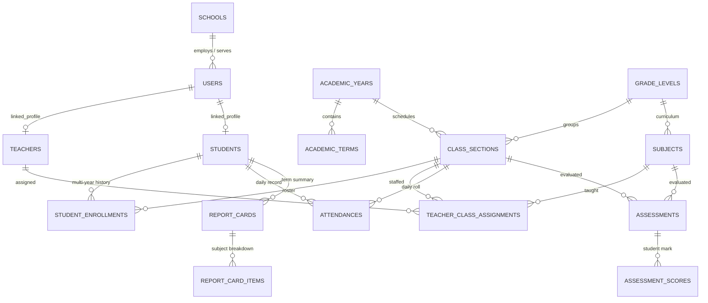

# Database Architecture and Migration Guide

## 1. Overview
The **Modern Ethiopian Elementary School Management System** relies on a normalized MySQL relational database designed with strict InnoDB transactional semantics, foreign key cascades, unique constraints, and `utf8mb4` encoding to natively support both English and Ethiopic (Amharic) text.

---

## 2. Character Set & Collation
- **Character Set**: `utf8mb4`
- **Collation**: `utf8mb4_unicode_ci`
- **Connection Parameters**: `characterEncoding=UTF-8&useUnicode=true&serverTimezone=UTC`

---

## 3. Entity-Relationship Model

---

## 4. Key Entities & Integrity Constraints

### 4.1. Students & Enrollment Progression
- `students`: Stores permanent student identity, unique `student_id_number` (e.g. `ATES-2026-001`), English full name, Amharic full name, birth date, gender, admission date, and emergency guardian contact.
- `student_enrollments`: Maintains the complete progression history across multiple academic years.
  - Unique Constraint: `(student_id, academic_year_id)`
  - Statuses: `ACTIVE`, `PROMOTED`, `REPEATING`, `TRANSFERRED`, `WITHDRAWN`
  - Rule: When promoting a student from Grade 1 to Grade 2, the previous year's enrollment is transitioned to `PROMOTED` and a new active enrollment is recorded for the subsequent year. Historical attendance and assessments remain permanently tied to the exact historical enrollment.

### 4.2. Teachers & Explicit Classroom Authorization
- `teachers`: Holds faculty profile, employee ID, specialization, qualifications, and phone/email.
- `teacher_class_assignments`: Strictly enforces which teacher is authorized to teach which subject in which section.
  - Unique Constraint: `(teacher_id, class_section_id, subject_id, academic_year_id)`
  - Flag: `is_primary_homeroom` identifies homeroom responsibilities.
  - Server-side validation: Before a teacher can take attendance or enter marks, the server verifies that an active assignment exists for that exact section and subject.

### 4.3. Daily Attendance
- `attendances`: Stores student daily attendance per class section.
  - Unique Constraint: `(student_id, attendance_date)`
  - Statuses: `PRESENT`, `ABSENT`, `LATE`, `EXCUSED`
  - Recorder tracking: `recorded_by_user_id` tracks accountability.

### 4.4. Assessments and Scores
- `assessments`: Created by authorized teachers for their assigned classes.
  - Attributes: title, type (`QUIZ`, `ASSIGNMENT`, `MIDTERM`, `FINAL`, `PROJECT`), `max_score`, `weight_percent`, and `assessment_date`.
- `assessment_scores`: Stores individual student marks.
  - Unique Constraint: `(assessment_id, student_id)`
  - Check constraint / Validation: `0 <= score <= max_score`.

### 4.5. Official Report Cards
- `report_cards`: Stores the term performance summary.
  - Attributes: `total_score`, `average_score`, `rank_in_class`, `conduct`, `attendance_present`, `attendance_absent`, `attendance_late`, `status` (`DRAFT`, `PUBLISHED`).
- `report_card_items`: Detailed subject breakdowns with raw mark, final percentage, letter grade (`A`, `B`, `C`, `D`, `F`), and remarks.

---

## 5. Automated Database Migrations
The system features an automated SQL migration runner (`util.DatabaseMigration`):
- Executes on servlet container startup via `servlet.AppContextListener`.
- Auto-creates the database `student_db` if missing.
- Applies versioned scripts in sequential order:
  1. `V1__init_schema.sql`: Complete DDL for 20 relational tables with foreign keys and indexes.
  2. `V2__seed_ethiopian_elementary_data.sql`: Addis Tesfa reference data, Grades 1-8 levels, class sections, Ethiopian elementary curriculum subjects, grading policies, and initial notices.
