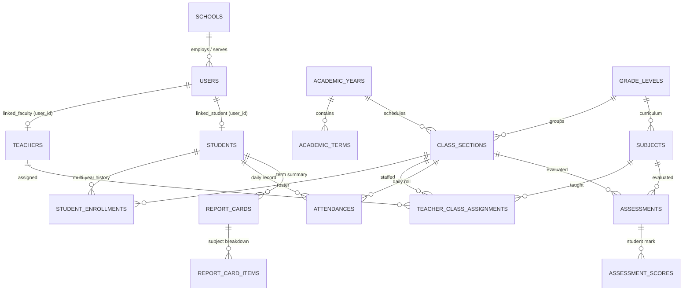

# Database Architecture and Migration Guide: Bule Hora Elementary School

## 1. Overview
The **Bule Hora Elementary School Management System** relies on a normalized MySQL relational database designed with strict InnoDB transactional semantics, foreign key cascades, unique constraints, and `utf8mb4` encoding to natively support both English and Ethiopic (Amharic) text.

---

## 2. Character Set & Collation
- **Character Set**: `utf8mb4`
- **Collation**: `utf8mb4_unicode_ci`
- **Connection Parameters**: `characterEncoding=UTF-8&useUnicode=true&serverTimezone=UTC`

---

## 3. Entity-Relationship Model

---

## 4. Key Entities & Integrity Constraints

### 4.1. Central User Authentication & Credential Storage
- **`users`**:
  - `id`: Primary key INT AUTO_INCREMENT.
  - `username`: UNIQUE VARCHAR(64). Custom login name chosen by administrator.
  - `password_hash`: Base64-encoded PBKDF2WithHmacSHA256 hash.
  - `password_salt`: Base64-encoded cryptographically secure 16-byte random salt.
  - `role`: VARCHAR(32) (`ADMIN`, `PRINCIPAL`, `TEACHER`, `REGISTRAR`, `ATTENDANCE_OFFICER`, `STUDENT`, `GUARDIAN`).
  - `full_name`: VARCHAR(128).
  - `email`: VARCHAR(128).
  - `phone`: VARCHAR(32).
  - `preferred_locale`: VARCHAR(8) (`en` or `am`).
  - `is_active`: BOOLEAN DEFAULT TRUE.
  - `created_at`: TIMESTAMP DEFAULT CURRENT_TIMESTAMP.

### 4.2. Teachers & Faculty Directory
- **`teachers`**:
  - `id`: Primary key INT AUTO_INCREMENT.
  - `user_id`: INT FOREIGN KEY REFERENCES `users(id)` ON DELETE SET NULL.
  - `employee_id`: UNIQUE VARCHAR(32) (e.g. `TCH-10042`).
  - `full_name_en`: VARCHAR(128).
  - `full_name_am`: VARCHAR(128).
  - `specialization`: VARCHAR(128).
  - `qualification`: VARCHAR(128).
  - `status`: VARCHAR(32) (`ACTIVE`, `INACTIVE`).

### 4.3. Students & Multi-Year Enrollment Progression
- **`students`**:
  - `id`: Primary key INT AUTO_INCREMENT.
  - `user_id`: INT FOREIGN KEY REFERENCES `users(id)` ON DELETE SET NULL (optional student portal login).
  - `student_id_number`: UNIQUE VARCHAR(32) (e.g. `BHES-2026-001`).
  - `first_name_en`, `last_name_en`, `first_name_am`, `last_name_am`.
  - `date_of_birth`: DATE.
  - `gender`: VARCHAR(10) (`MALE`, `FEMALE`).
  - `admission_date`: DATE.
  - `guardian_name`, `guardian_phone`, `guardian_relationship`.
- **`student_enrollments`**:
  - Unique Constraint: `(student_id, academic_year_id)`
  - Statuses: `ACTIVE`, `PROMOTED`, `REPEATING`, `TRANSFERRED`, `WITHDRAWN`.
  - Rule: Promoting a student creates a new active enrollment record while marking previous years as `COMPLETED` or `PROMOTED`. Historical marks and attendance remain attached to the exact historical enrollment.

### 4.4. Teacher Class & Subject Assignments
- **`teacher_class_assignments`**:
  - Unique Constraint: `(teacher_id, class_section_id, subject_id, academic_year_id)`.
  - Flag: `is_primary_homeroom` identifies homeroom responsibilities.
  - Server-side validation: Verifies that an active assignment exists before allowing a teacher to take attendance or enter marks for that section and subject.

### 4.5. Daily Classroom Attendance
- **`attendances`**:
  - Unique Constraint: `(student_id, attendance_date)`.
  - Statuses: `PRESENT`, `ABSENT`, `LATE`, `EXCUSED`.
  - Recorder tracking: `recorded_by_user_id` tracks accountability.

### 4.6. Continuous Assessments & Scores
- **`assessments`**: Created by authorized teachers for their assigned classes (`QUIZ`, `ASSIGNMENT`, `MIDTERM`, `FINAL`, `PROJECT`).
- **`assessment_scores`**:
  - Unique Constraint: `(assessment_id, student_id)`.
  - Boundary constraint: `0 <= score <= max_score`.

### 4.7. Official Term Report Cards
- **`report_cards`**: Term performance summary (`total_score`, `average_score`, `rank_in_class`, `conduct`, `attendance_present`, `attendance_absent`, `status` (`DRAFT`, `PUBLISHED`)).
- **`report_card_items`**: Subject breakdowns with raw mark, final percentage, letter grade (`A`, `B`, `C`, `D`, `F`), and teacher remarks.

---

## 5. Automated Database Migrations
The system features an automated SQL migration runner (`util.DatabaseMigration`):
- Executes on servlet container startup via `servlet.AppContextListener`.
- Auto-creates the database `student_db` if missing.
- Applies versioned scripts in sequential order:
  1. `V1__init_schema.sql`: Complete DDL for 20 relational tables with foreign keys and indexes.
  2. `V2__seed_ethiopian_elementary_data.sql`: Bule Hora reference data, Grades 1-8 levels, class sections, Ethiopian elementary curriculum subjects, grading policies, initial staff accounts, and announcements.
